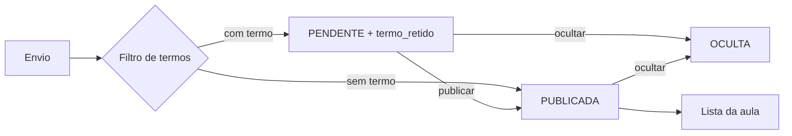

# Arquitetura — Participa

## Camadas
Controller (HTTP, validação) → Service (regra de negócio, transação) → Repository (Spring Data JPA). DTOs (records) são a única coisa que sai pela API: **entidade nunca sai**. A montagem de `DuvidaDTO` fica num só lugar (`DuvidaMapper`), que zera `autorNome` de dúvida anônima para qualquer perfil.

## Pacotes (`br.edu.utfpr.participa`)
`config`, `comum` (erros, ErroDTO), `usuario`, `turma`, `aula`, `duvida`, `tema`, `termometro`, `moderacao`, `privacidade`, `resumo`. Cada pacote de domínio tem Entidade, Repository, Service, Controller e `dto/`.

## Modelo de dados
Seção 8 do plano (migrações V1 a V9, número reservado por branch; `out-of-order=true` só no perfil local).

## Decisões tomadas
Q1 nome "Participa" em `app.nome`; Q2 Java 21, Spring Boot padrão do start.spring.io, PostgreSQL, JS sem framework; Q3 domínios @alunos.utfpr.edu.br / @utfpr.edu.br (a confirmar); Q4 "próxima aula" = 7 dias, 23:59; Q5 banco `participa_test`; Q6 e Q7 em aberto.

## Anonimato
`autor_id` fica gravado (histórico, apoio duplicado, exclusão), mas nenhuma rota devolve o autor de dúvida anônima. Quem acessa o banco diretamente consegue ver; o termo de uso informa isso.

## Fluxo de uma dúvida

